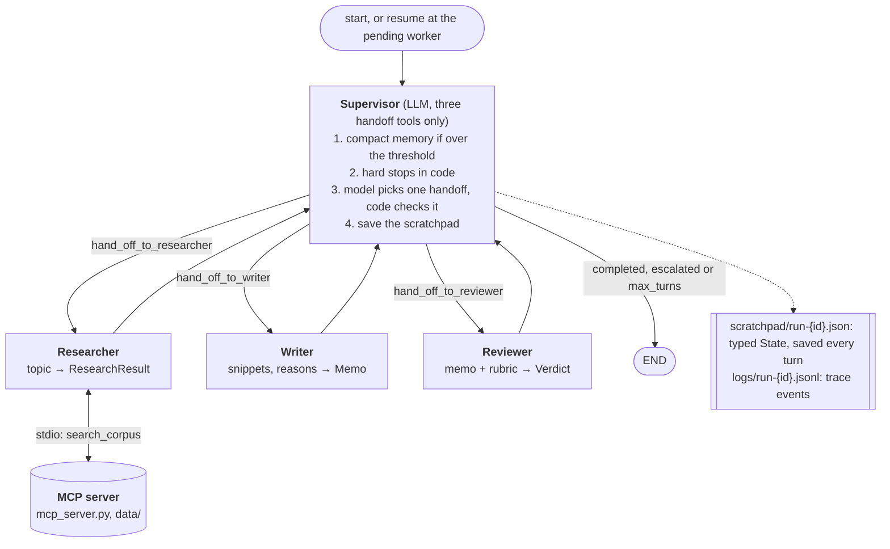

# Architecture

A LangGraph `StateGraph` with four nodes. The supervisor decides who works next; three workers each do one bounded job and return a typed result. Every limit is defined once in code; this doc names the constant instead of repeating its value, so the two cannot drift apart.

## Role boundaries

| Role | Reads | Tools | Returns | Enforced by |
|---|---|---|---|---|
| Supervisor | A status card: topic, source IDs, draft length, last verdict, counts; plus the rolling summary once one exists | `hand_off_to_researcher`, `_writer`, `_reviewer` (no arguments) | A handoff, or END | `HANDOFFS` and `supervisor_request` (`team.py`, `core/prompts.py`); it never sees the evidence or the memo text |
| Researcher | `topic` | MCP `search_corpus` only, over stdio | `ResearchResult` (1–5 snippets, unique sources) | `_research` in `team.py`; `core/mcp_client.py` |
| Writer | `topic`, `snippets`; when revising, its previous draft and `review_verdict.reasons` | none | `Memo` (title, body, footnotes) | `writer` in `team.py` |
| Reviewer | `draft_memo` and the static `RUBRIC`, never the evidence | none | `Verdict` (accept or revise, with reasons) | `reviewer` and `verify` in `team.py` |

- **No free-form chat between agents.** Handoff tools take no arguments, and workers read only typed state fields. The `messages` log is memory for compaction, not a channel; no worker reads it.
- **No MCP bypass.** Team code never opens `data/`. Only `mcp_server.py` and `evaluate.py` import `core/corpus.py`.
- **Guarded by tests.** `tests/test_boundaries.py` checks these rules in the source (only the Researcher touches MCP, no team code reads the corpus, the Reviewer reads only the memo, the supervisor never calls a worker, no worker reads `messages`). `tests/test_supervisor.py` checks that the supervisor's only tools are the three argument-free handoffs.

**Researcher.** It searches the topic once. If that finds fewer than `MIN_SNIPPETS`, the model proposes up to `MAX_SUBQUERIES` typed sub-queries, which also run through MCP. It never pads: each topic has two on-topic paragraphs in the corpus, so a shortfall is logged (`research_done.shortfall`), not hidden.

**Writer.** It drafts from the snippets with the same `MEMO_RULES` the baseline uses. If the body is outside the length range, code counts the words and gives the model one repair call with the exact count (`fix_length`). Revisions change only the sentences the Reviewer quoted.

**Reviewer: the model proposes, code verifies, code decides.** `check_memo` (`core/text.py`) checks length, citation presence and footnote matching in code. The model returns typed findings, each quoting a sentence. `verify` drops a finding when the quote is not in the memo, when the sentence is attributed to a citation, when an "uncited figure" sentence has a citation or no figure, or when the sentence is a plain statement of missing data (`states_missing_data`). The verdict is `revise` if any check fails or any verified finding remains.

## Supervisor turn and stop conditions

Each visit to the supervisor (`supervisor` in `team.py`):

1. Saves the scratchpad, then runs `maybe_compact` (below).
2. Checks the hard stops in code, before any model call, in this order (`stop_reason`):

   | Condition | Status |
   |---|---|
   | The Reviewer accepted the draft | `completed` |
   | `rejections` reached `MAX_REJECTIONS` | `escalated` (needs a human) |
   | Research ran and found nothing | `escalated` |
   | `turn_count` reached `MAX_TURNS` | `max_turns` |

   Accept is checked first, so a memo accepted on the last turn is `completed`. The stop reason is logged as a `stop` event.
3. Otherwise counts one turn and asks the model for exactly one handoff (`tool_choice="required"`). Code redirects only an impossible handoff, such as the writer with no evidence or the reviewer with no unreviewed draft (`blocked`, `fallback_handoff`), and logs the redirect.
4. Saves the scratchpad with the chosen worker in `pending`, and hands off.

The limits are in `core/config.py`.

## Shared scratchpad and resume

- **State.** `State` in `core/schemas.py` is a `TypedDict` with the seven required keys (`topic`, `snippets`, `draft_memo`, `review_verdict`, `turn_count`, `summary`, `status`) plus run bookkeeping: `run_id`, `topic_id`, `pending`, `rejections`, `mcp_calls`, `total_tokens`, `messages` and `trace`. Worker outputs are stored as dumped Pydantic models.
- **Persistence.** `save_state` (`core/scratchpad.py`) writes `scratchpad/run-<id>.json` atomically: a temporary file, `fsync`, then `os.replace`. A kill at any moment leaves the last complete save. The supervisor saves on entry, after a compaction, and at the end of every turn.
- **Resume.** `start_state` (`team.py`) loads an unfinished run and validates every field against `State` (`load_state`). The graph's entry point (`entry_point`) goes straight to the `pending` worker, so a resume spends no supervisor turn and does not repeat finished work. A corrupt file, or one about another topic, stops the run instead of being overwritten. A finished run starts fresh; `--fresh` forces that.
- **Limit.** A worker killed in the middle of a model call is run again, and the tokens of the lost call are not counted.

## Rolling-summary memory

`maybe_compact` in `core/memory.py`, called at the start of every supervisor turn:

- **Trigger.** The `messages` log is counted with LangChain's `get_num_tokens_from_messages` (falling back to an estimate if the tokenizer is unavailable). If it is above `COMPACTION_TOKENS`, all but the last `KEEP_RECENT_MESSAGES` messages are replaced.
- **What the summary keeps.** Code writes the required facts from typed state and the trace: the topic, every handoff, each rejection with its reasons, and the current draft's word count. The model adds a short narrative of why each role ran and what changed between drafts. Because code writes the facts, they cannot be dropped.
- **Idempotent.** The summary is one message named `summary`. After a compaction it is the only older message, so a second call changes nothing and makes no model call. Earlier summaries are folded into the new one, never stacked. Removal uses LangGraph's `RemoveMessage`, with no custom reducer.
- **Evidence.** It fired once in the full evaluation (T03, at the real threshold). `tests/test_memory.py` covers the threshold, the kept facts and idempotency.

## Evaluation notes

- **Same inputs for both systems.** Same model, temperature, memo rules, corpus and topics. The baseline sees the whole corpus in one call; the team retrieves through MCP and has a review loop and a length repair. These differences are the architecture being compared.
- **Word count.** `evaluate.py` counts only the memo body for both systems (`parse_memo`, `body_word_count`). The starter evaluator, and `EVALUATION.md`, count the whole memo, including title and footnotes. Both counts are in the results. Under the whole-memo count, three baseline memos in the full run would fail length (T01 396, T02 377, T04 452 words) and no team memo would.
- **Rubric.** Automatic checks cannot judge factual support, so every memo was reviewed by hand against the corpus. The rules and the reason for each verdict are in `results/MANUAL_REVIEW.md`.

## Known limitations

- The Reviewer never sees the evidence, so it cannot catch a well-formed but wrong citation, and its model can miss violations (it accepted T01 with an uncited figure). The Writer logs citations outside its evidence (`stray_citations`), and the evaluator flags IDs outside the corpus.
- The team costs about 7 times the baseline's tokens.
- One run per topic at temperature 0 does not measure run-to-run variation.
